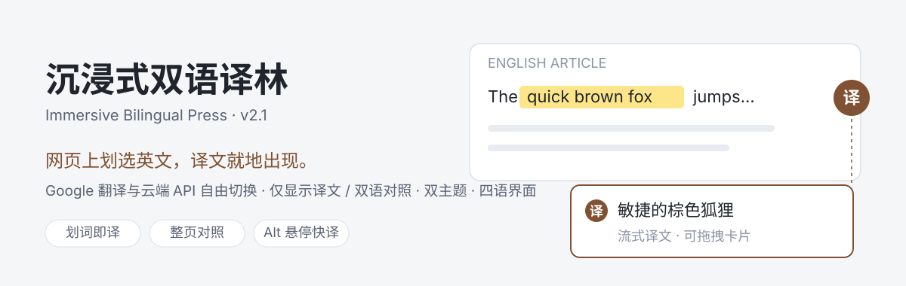

# 沉浸式双语译林 · Immersive Bilingual Press `v2.1`

[简体中文](README.md) | [English](README_EN.md)

  

---

## 🇨🇳 简体中文说明

**沉浸式双语译林 (Immersive Bilingual Press) v2.1** 是一款基于 Chrome / Edge Manifest V3 标准开发的开源网页翻译扩展。支持**Google翻译**与**OpenAI 兼容云端 API**（OpenAI / DeepSeek / Moonshot / OpenRouter / Groq / xAI / Qwen 等）两种引擎，内置**「双语对照 / 仅显示译文」两种显示模式**（默认仅显示译文）与**「复古报刊书籍」**、**「液态玻璃」**两套视觉主题，并提供**简体中文、繁體中文、English、日本語**四种插件界面语言。

### ✨ v2.1 核心特性

| 功能特性 | 详细说明 |
| :--- | :--- |
| **🌍 多语种自由互译** | 支持源语言自动检测及简中、繁中、英、日、韩、法、德、西、俄、葡、阿等 12 种语言任意互译，内置 `⇄` 一键互换与跨语种防复读校验（彻底解决中文译日语等场景不翻译的问题）。 |
| **🖥️ 双语对照 / 仅显示译文** | 整页翻译提供两种显示模式：**双语对照**（原文在上、译文在下）与**仅显示译文**（隐藏原文、只保留译文），默认使用「仅显示译文」。 |
| **⚡ Google翻译 + 云端 API** | 可一键使用 Google翻译；也可在「云端 API」中填写 **OpenAI 兼容服务商**（OpenAI / DeepSeek / Moonshot / OpenRouter / Groq / xAI / Qwen 等）的 API Key、模型名与接口地址。 |
| **📜 复古书报 & 🫧 液态玻璃双主题** | 保留两种网页译文样式；弹窗和设置页采用统一的简洁界面，随主题使用棕色或蓝色强调。 |
| **🧭 精简弹窗 + 独立设置页** | 弹窗只保留语种方向、引擎选择、翻译/还原和「打开设置页」入口；详细配置在独立标签页完成，支持语言、引擎、外观、交互和浏览器快捷键管理。 |
| **🗣️ 四国插件界面语言** | 插件内置**简体中文、繁體中文、English、日本語**界面切换，弹窗与网页内划词卡片、悬浮书签实时同步。 |

### 🚀 快速安装与使用指南

1. 下载并解压扩展发布包。
2. 在浏览器地址栏打开扩展管理页：
   - **Chrome**：`chrome://extensions/`
   - **Edge**：`edge://extensions/`
3. 开启右上角或左侧的 **「开发者模式 (Developer mode)」**。
4. 点击 **「加载已解压的扩展程序 (Load unpacked)」**，选择包含 `manifest.json` 的文件夹即可完成安装。
5. **三种翻译交互方式**：
   - **整页翻译（仅显示译文 / 双语对照）**：在弹窗选择语种和引擎，点击翻译按钮或网页圆形悬浮球；按住悬浮球可用鼠标拖动位置。在设置页「语种与引擎 → 整页显示模式」中选择**仅显示译文**（默认、优先排列）或**双语对照**，再次点击翻译按钮可还原。译文语言由目标语种决定。
   - **鼠标划词翻译**：选中网页中的英文词句，点击旁侧浮现的「译」图标弹出可拖拽流式译文卡片；中文等非英文内容不会显示该按钮。
   - **Alt 悬停段落快译**：将鼠标指针悬停在任意网页段落上，按一下键盘 `Alt` 键即可单独翻译或还原该段落。
6. 点击弹窗中的**「打开设置页」**，也可从浏览器扩展菜单的「选项」进入。普通偏好即时保存，云端 API 配置需点击保存按钮。
7. 在设置页「交互与快捷键」查看实际整页翻译快捷键，并通过**「管理浏览器快捷键」**修改。默认建议为 `Alt + A`；若与其他扩展冲突，需在浏览器中分配可用组合。

---

## 👨‍💻 关于我

**大强同学（Derek Zhao）**
AI 工具与工作流实践者 · GitHub 开源项目作者

我在 Windows、AI Agent、Obsidian 和个人网站这些真实场景里，
把能跑通的工具、Skill 和流程，整理成可复用的开源项目与交付方案。

- 文章与工具：[dqtx.cc](https://www.dqtx.cc/) · [os.dqtx.cc](https://os.dqtx.cc/) · [blog.dqtx.cc](https://blog.dqtx.cc/)
- 关注更新：[B 站](https://space.bilibili.com/491358682/upload/video) · [YouTube](https://www.youtube.com/@dqtx760/videos) · [即刻](https://web.okjike.com/u/24236868-c3e9-49ef-ab93-93a60e1a25db) · [CSDN](https://blog.csdn.net/2402_82616859?type=blog)
- 公众号：微信搜索「大强同学」

卡在安装、配置、报错，或想把 AI 接进自己的工作流，可以直接找我。
